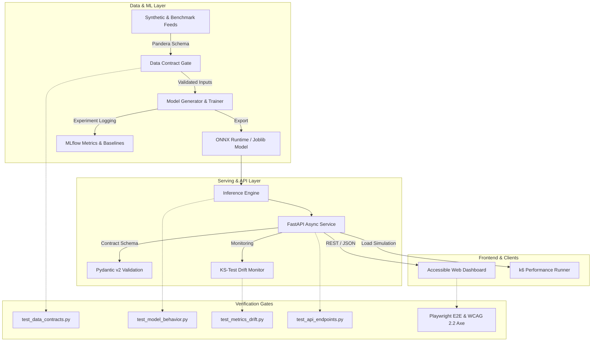

# EvalShield-AI

> **Production-Grade End-to-End Test Suite & MLOps Guardrail Pipeline for AI Systems**

[](https://github.com/org/evalshield-ai/actions)
[](https://www.python.org/downloads/)
[](https://fastapi.tiangolo.com)
[](https://onnxruntime.ai)
[](https://pandera.readthedocs.io)
[](https://playwright.dev)
[](https://www.w3.org/WAI/standards-guidelines/wcag/)

---

## 1. Architectural Overview

EvalShield-AI is a modular, enterprise-grade quality engineering platform and safety guardrail engine for AI/LLM applications. It provides full-stack quality governance across every layer of the modern AI lifecycle:



---

## 2. Directory Structure

```text
evalshield-ai/
├── .github/
│   └── workflows/
│       └── ci-cd-pipeline.yml     # Multi-stage GitHub Actions CI/CD automation
├── docker/
│   ├── Dockerfile.api             # Hardened Python 3.11 slim container (non-root)
│   ├── Dockerfile.frontend        # Lightweight Nginx Alpine reverse proxy
│   └── docker-compose.yml         # Full-stack container orchestration
├── src/
│   ├── api/
│   │   ├── __init__.py
│   │   ├── main.py                # Production FastAPI service with middleware & lifespan
│   │   └── schemas.py             # Pydantic v2 schemas and validation contracts
│   └── ml/
│       ├── __init__.py
│       ├── inference.py           # ONNX Runtime engine with fallback and heuristic guardrails
│       └── model_generator.py     # Training pipeline, baseline generator, MLflow logger
├── tests/
│   ├── ml_quality/
│   │   ├── __init__.py
│   │   ├── test_data_contracts.py # Pandera schema contracts & boundary assertions
│   │   ├── test_model_behavior.py # CheckList behavioral tests (MFT, INV, DIR)
│   │   └── test_metrics_drift.py  # Kolmogorov-Smirnov & PSI drift detection tests
│   ├── api/
│   │   ├── __init__.py
│   │   └── test_api_endpoints.py  # Async integration tests with httpx
│   ├── e2e_ui/
│   │   ├── specs/
│   │   │   ├── dashboard.spec.ts  # End-to-end interactive workflow tests
│   │   │   ├── visual.spec.ts     # Visual & responsive viewport tests
│   │   │   └── a11y.spec.ts       # WCAG 2.2 AA automated accessibility audits
│   │   ├── playwright.config.ts   # Playwright configuration with webServer
│   │   └── package.json           # Node.js dependencies (@axe-core/playwright, etc.)
│   └── performance/
│       └── load-test.js           # k6 load testing script with stages & SLA thresholds
├── index.html                     # WCAG 2.2 AA compliant interactive shield dashboard
├── requirements.txt               # Locked Python dependencies
├── pytest.ini                     # Pytest runner configuration
└── README.md                      # Architecture, verification & deployment manual
```

---

## 3. Technology Stack & Key Decisions

| Domain | Technology | Justification |
| :--- | :--- | :--- |
| **Backend & Serving** | FastAPI, Pydantic v2 | High-throughput asynchronous REST API with automatic OpenAPI specs and sub-millisecond serialization. |
| **Inference Acceleration** | ONNX Runtime | High-performance CPU execution provider with graph optimization; decoupled from heavyweight framework runtimes. |
| **Data Contracts** | Pandera | Deterministic statistical data contracts validating physical and logical domain boundaries at runtime. |
| **Behavioral ML Testing** | Pytest, CheckList | Systematic categorization of tests into Minimum Functionality Tests (MFT), Invariance (INV), and Directional Expectation (DIR). |
| **Drift Monitoring** | SciPy (KS-Test), PSI | Two-sample Kolmogorov-Smirnov test and Population Stability Index comparing production windows to baseline distributions. |
| **UI & E2E Testing** | Playwright, TypeScript | Reliable multi-browser automation with integrated webServer orchestration. |
| **Accessibility (A11y)** | `@axe-core/playwright` | Zero-violation enforcement against WCAG 2.2 Level AA accessibility standards. |
| **Performance Testing** | k6 | Distributed, code-driven virtual user simulation measuring p95/p99 latency budgets and error rates. |
| **Containerization** | Docker, Docker Compose | Multi-stage, non-root hardened containers with integrated health checks and Nginx reverse proxy. |

---

## 4. Local Quickstart

### Prerequisites
- Python 3.11+
- Node.js 20+
- (Optional) Docker & Docker Compose
- (Optional) k6 (for performance tests)

### Step 1: Clone and Set Up Python Environment

```bash
git clone https://github.com/your-org/evalshield-ai.git
cd evalshield-ai

# Create virtual environment
python3.11 -m venv .venv
source .venv/bin/activate

# Install Python dependencies
pip install --upgrade pip
pip install -r requirements.txt
```

### Step 2: Train & Compile the Model Artifacts

```bash
python -m src.ml.model_generator
```
*Generates `evalshield_model.onnx`, `evalshield_model.joblib`, `baseline_distribution.parquet`, and `metadata.json` under `src/ml/artifacts/`.*

### Step 3: Run the FastAPI Service

```bash
uvicorn src.api.main:app --host 0.0.0.0 --port 8000 --reload
```
- Swagger Interactive Documentation: [http://localhost:8000/docs](http://localhost:8000/docs)
- Health Check: [http://localhost:8000/health](http://localhost:8000/health)

### Step 4: Open the Web UI Dashboard

You can serve the static dashboard with any HTTP server:
```bash
python3 -m http.server 8080
```
Visit [http://localhost:8080](http://localhost:8080) to interact with the live guardrail playground.

---

## 5. Running the Test Suites

### A. ML Quality, Data Contracts & Behavioral Tests
```bash
pytest tests/ml_quality -v
```
Runs:
- `test_data_contracts.py`: Validates Pandera contract rules, out-of-bounds rejection, and null checks.
- `test_model_behavior.py`: Executes MFT (severe attacks blocked, benign allowed), INV (entropy jitter), and DIR (monotonic injection risk).
- `test_metrics_drift.py`: Validates Kolmogorov-Smirnov 2-sample tests, PSI buckets, and model performance baselines.

### B. API Integration & Contract Tests
```bash
pytest tests/api -v
```
Runs:
- Async endpoint tests verifying `/health`, `/model/metadata`, single `/evaluate`, batch `/evaluate/batch`, and `/drift/check`.
- Tests schema validation failures (HTTP 422).

### C. Frontend E2E, Visual & Accessibility Tests
```bash
cd tests/e2e_ui
npm install
npx playwright install --with-deps chromium

# Run all Playwright tests
npm test

# Run WCAG 2.2 accessibility tests exclusively
npm run test:a11y

# Run visual regression tests
npm run test:visual
```

### D. Performance & Load Testing with k6
```bash
k6 run tests/performance/load-test.js
```
Validates:
- `http_req_duration`: p(95) < 120ms, p(99) < 250ms
- `http_req_failed`: error rate < 1%

---

## 6. Docker Orchestration

Run the complete multi-service stack (FastAPI Backend + Nginx Reverse Proxy Frontend):

```bash
docker compose -f docker/docker-compose.yml up --build -d
```

Check service status and health:
```bash
docker compose -f docker/docker-compose.yml ps
```

Access services:
- **Web UI & Reverse Proxy:** [http://localhost:8080](http://localhost:8080)
- **Direct Backend API:** [http://localhost:8000/docs](http://localhost:8000/docs)

Teardown:
```bash
docker compose -f docker/docker-compose.yml down -v
```

---

## 7. CI/CD Pipeline Architecture

The `.github/workflows/ci-cd-pipeline.yml` workflow enforces the following gates on every Pull Request:

1. **Lint & Typecheck:** Static analysis with `ruff` across all modules.
2. **ML Quality Suite:** Enforces data contracts and CheckList behavior gates with coverage metrics.
3. **API Contract Tests:** Asserts HTTP status codes and contract conformance.
4. **E2E UI & Accessibility:** Headless Playwright runner executing browser automation and `@axe-core/playwright` WCAG 2.2 audits.
5. **Docker Build Verification:** Automated compose deployment and healthcheck verification.

---

## 8. Quality Gates & SLA Thresholds

| Metric | Target SLA | Test Enforcement |
| :--- | :--- | :--- |
| **Model Accuracy** | $\ge 85.0\%$ | `test_metrics_drift.py` |
| **Model Macro F1** | $\ge 80.0\%$ | `test_metrics_drift.py` |
| **Single Inference Latency** | $< 30\text{ ms}$ | `test_model_behavior.py` |
| **API p95 Response Time** | $< 120\text{ ms}$ under 40 VUs | `load-test.js` (k6) |
| **API Error Rate** | $< 1.0\%$ | `load-test.js` (k6) |
| **Accessibility Compliance** | $0$ WCAG 2.2 AA Violations | `a11y.spec.ts` (Axe-Core) |
| **Data Contract Integrity** | $100\%$ schema conformity | `test_data_contracts.py` (Pandera) |
